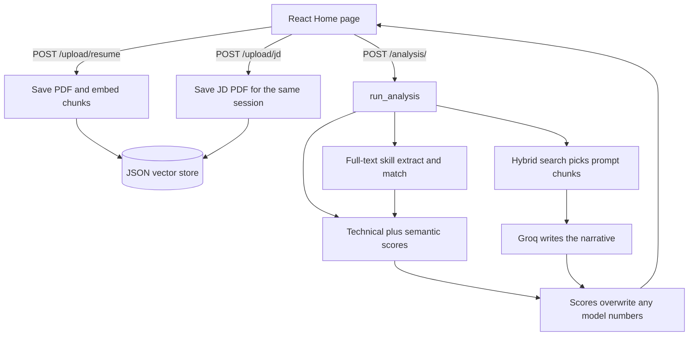

# Resume–JD Matcher

A local web app that compares a resume PDF with a job-description PDF. It extracts skills, computes a technical score and a semantic similarity score, then asks a Groq chat model to write strengths, weaknesses, suggestions, and a short summary. The model is not allowed to change the numeric scores.

The saved quality numbers in this repository come from **8 synthetic text scenarios**, not from production traffic or real PDF uploads. See [Evaluation](#evaluation).

## Objectives

- Turn two PDFs into one session and one analysis.
- Score skill coverage with a fixed formula, including partial credit for related skills.
- Measure semantic similarity with `sentence-transformers/all-MiniLM-L6-v2` (ONNX, 384-dimensional vectors).
- Use hybrid retrieval only to choose the chunks that go into the language-model prompt.
- Keep scores and skill lists under backend control.

## Features that are implemented

- PDF upload for a resume, then a job description, tied together by a server-generated UUID.
- Checks: `%PDF-` magic bytes, size limit (`MAX_FILE_SIZE_MB`), 1–20 pages, at least 30 words of extractable text. There is no OCR.
- Chunking with `RecursiveCharacterTextSplitter` (`chunk_size=800`, `chunk_overlap=150`).
- Session-scoped JSON vector store plus BM25 keyword search, fused with reciprocal rank fusion (RRF, `k=60`).
- Skill extraction in two modes: `rules` (vocabulary and mining, no extra model call) and `hybrid` (rules plus a Groq extraction that is kept only if the skill appears in the document). Default in `.env.example` is `hybrid`. The Render blueprint sets `rules`.
- Scores: technical, semantic, and overall. Related skills earn 0.5 (tight group) or 0.25 (broad group).
- Narrative fields from Groq at temperature 0: strengths, weaknesses, suggestions, summary, `domain_match`, `analysis_confidence`.
- React interface: upload progress, circular overall score, technical and semantic scores, matched and missing skills, and the narrative.
- Optional LangSmith tracing.
- An evaluation harness (`python -m evaluation.run_eval`) and 12 offline skill tests.
- A Docker image and `render.yaml` for a single free Render web service. This README does not claim that a public deployment is live.

Returned by the API but not shown in the dashboard: `resume_skills`, `jd_skills` (used only to decide whether the technical score is `N/A`), `related_skills`, and `analysis_confidence`. Reset in the UI clears the page. It does not delete uploaded PDFs or stored chunks.

## Where this is useful

A candidate can see which job skills were found, which are missing, and a written explanation that is supposed to stay inside the uploaded text. A reviewer can inspect the formula and the evaluation file instead of trusting a single percentage.

This is not an applicant-tracking system, not a hiring decision, and not a benchmark of real resumes.

## Technologies

| Piece | What the code uses |
|---|---|
| API | FastAPI, Uvicorn, Pydantic, `pydantic-settings` |
| UI | React 19, Vite 8, Tailwind CSS 4, Axios |
| PDFs | `pypdf` |
| Chunks | `langchain-text-splitters` |
| Chat model | `langchain-groq` `ChatGroq`, model name from `GROQ_MODEL` |
| Embeddings | `fastembed` `TextEmbedding` of `sentence-transformers/all-MiniLM-L6-v2` |
| Vector store | `LocalVectorStore` in `backend/app/rag/vectordb.py` (one JSON file per collection) |
| Keyword search | `rank_bm25.BM25Okapi` |
| Similarity | NumPy cosine similarity |
| Tracing and eval | `langsmith` (optional) |
| Container | `Dockerfile` (Node 24 build stage, Python 3.11 runtime, `libgomp1`) |

`requirements.txt` does not install PyTorch, ChromaDB, `sentence-transformers`, or scikit-learn. The setting name `CHROMA_DB_PATH` is only the directory for the JSON files. An older `data/chroma` SQLite database may still be on disk from an earlier version. The current store does not read it.

## Architecture



Hybrid search selects at most 8 chunks per document for the prompt (4 queries, 3 BM25 hits and 3 vector hits each, then RRF). Skill lists use the full text. Semantic similarity compares every job chunk with its closest resume chunk.

## Workflow

1. The browser posts the resume PDF. The API creates a UUID, checks the file, extracts text, chunks it, and stores embeddings under `resume_collection`.
2. The browser posts the job description with that `session_id`. The same steps run for `jd_collection`.
3. `POST /analysis/` loads both collections. If either is missing, the API returns 404.
4. Skills are extracted, matched, and given partial credit when a related skill is present.
5. Scores are computed.
6. Groq receives the selected chunks plus the already computed scores and skill lists, and must return JSON.
7. The response merges model text first, then scores, then skill lists, so the model cannot replace those fields.

## Installation

From the project root, with Python 3.11:

```bash
python -m venv venv
venv\Scripts\activate
pip install -r requirements.txt
copy .env.example .env
```

Put your own Groq key in `.env`. Do not commit `.env`.

```bash
cd frontend
npm ci
npm run dev
```

In another terminal, from the project root:

```bash
venv\Scripts\activate
uvicorn backend.app.main:app --reload --host 127.0.0.1 --port 8000
```

Vite serves the UI (default `http://127.0.0.1:5173`). In development, Axios calls `http://127.0.0.1:8000` unless `VITE_API_URL` is set. A production build uses the same host as the page, which is how the Docker image serves the built UI and the API together.

Health check: `GET http://127.0.0.1:8000/api/v1/health` returns `{"status":"healthy"}`. It does not check Groq or the embedding model. The model loads on a background thread after startup.

### Docker

```bash
docker build -t resume-jd-matcher .
docker run --env-file .env -p 8000:8000 resume-jd-matcher
```

`render.yaml` describes one free Docker web service, health path `/api/v1/health`, skill mode `rules`, and writable paths under `/tmp/matcher`. Set `GROQ_API_KEY` in the host’s dashboard. Free-tier disk under `/tmp` does not survive sleep.

## API

| Method | Path | Role |
|---|---|---|
| GET | `/api/v1/health` | Liveness |
| POST | `/upload/resume` | Multipart field `file`. Returns `session_id`, pages, chunks |
| POST | `/upload/jd` | Multipart fields `session_id` and `file` |
| POST | `/analysis/` | JSON `{"session_id": "..."}` |

`GET /` and `GET /{path}` serve `frontend/dist` when that folder exists.

```bash
curl -F "file=@resume.pdf" http://127.0.0.1:8000/upload/resume
curl -F "session_id=SESSION" -F "file=@jd.pdf" http://127.0.0.1:8000/upload/jd
curl -H "Content-Type: application/json" -d "{\"session_id\":\"SESSION\"}" http://127.0.0.1:8000/analysis/
```

Common status codes: 400 invalid PDF or session id, 413 over the size limit, 404 session or document missing, 502 Groq failed or returned unusable JSON, 500 unexpected processing error. Error bodies do not include the API key.

Analysis JSON includes `overall_score`, `technical_score`, `semantic_similarity`, `resume_skills`, `jd_skills`, `matched_skills`, `missing_skills`, `related_skills` (`skill`, `credit`, `via`), `strengths`, `weaknesses`, `suggestions`, `summary`, `domain_match`, and `analysis_confidence`.

## Scoring

If the job description has at least one extracted skill:

```text
technical = min(100, (matched_count + related_credit) / jd_skill_count * 100)
overall   = 0.6 * technical + 0.4 * semantic
```

`0.6` is `SKILL_SCORE_WEIGHT`. If the job description has no extracted skills, overall equals the semantic score, and the UI shows technical as `N/A`.

Semantic score: embed every chunk, cosine-match each job chunk to its nearest resume chunk, average those maxima, clamp to 0–1, multiply by 100.

## Evaluation

Saved file: `evaluation/results/latest.json`.

| Fact | Value |
|---|---|
| Examples | 8 synthetic resume/JD texts |
| Models recorded | Groq and judge both `openai/gpt-oss-20b` |
| Embedding recorded | `sentence-transformers/all-MiniLM-L6-v2` |
| Chunks recorded | 800 / 150 |
| Skill weight recorded | 0.6 |
| Skill mode recorded | Not present in this file |

Averages are the unweighted mean of the eight per-example scores.

| Metric | Mean |
|---|---:|
| JD skill precision / recall / F1 | 0.875 / 0.840 / 0.856 |
| Resume skill precision / recall / F1 | 0.625 / 0.530 / 0.564 |
| Matched-skill F1 | 0.868 |
| Missing-skill F1 | 0.979 |
| Score inside the labelled band | 0.875 (7 of 8) |
| Score formula consistent | 1.000 |
| Spearman vs human tier | 0.927 (computed by `score_rank_correlation`, not stored in the JSON) |
| Strong vs weak/mismatch gap | 66.52 points (3 strong and 3 weak or mismatch; partial cases excluded) |
| Mean latency | 6.64 s (range 1.38–12.28). Text through `run_analysis` only |
| Injection phrase check | 1.000 |
| Faithfulness judge | 0.800 (the injection example alone is 0.167) |
| Suggestion-quality judge | 0.908 |

Resume-skill F1 is 0.564 because `accountant_vs_ai_intern`, `prompt_injection_in_resume`, and `marketing_match_no_vocab_skills` each scored 0. `ml_student_vs_ai_intern` scored 25.59, which is 4.41 points below its 30–65 band.

`evaluation/dataset_unseen.py` has 6 more labelled examples. No results file is saved for them. There is no production latency or throughput report.

Offline tests, run from the project root on 24 Nov 2026:

```text
python -m pytest tests/test_skill_extraction.py -q -p no:cacheprovider
12 passed in 0.37s
```

Those tests force rules mode and do not call Groq. They are not the F1 numbers above.

```bash
python -m evaluation.run_eval --local
python -m evaluation.run_eval --local --no-judge
python -m evaluation.run_eval --set unseen --skill-mode rules
```

`--local` overwrites `evaluation/results/latest.json`. The harness writes chunks into a temporary directory and deletes them afterward. It does not upload PDFs.

## Project structure

```text
backend/app/main.py                 API, CORS, health, static UI, model warm-up
backend/app/core/config.py          Settings from the project-root .env
backend/app/core/skills.py          76 base skill names
backend/app/core/skills_extended.py 63 added names, groups, implication rules
backend/app/core/tracing.py         Optional LangSmith environment export
backend/app/api/routes/             upload, jd, analysis
backend/app/rag/                    PDF load, split, ONNX embeddings, JSON store, BM25, RRF
backend/app/services/               context, skills, scoring, Groq narrative
backend/app/prompts/analysis_prompt.py
frontend/src/                       React upload and results UI
evaluation/                         8 + 6 labelled examples, evaluators, latest.json
tests/test_skill_extraction.py      12 rules-mode tests
Dockerfile, render.yaml
```

`backend/test_loader.py` imports `app.rag` and a hardcoded PDF path. It is not part of the pytest suite.

## Configuration

Copy `.env.example`. Required: `GROQ_API_KEY`, `GROQ_MODEL`, `EMBEDDING_MODEL`, `CHROMA_DB_PATH`, `UPLOAD_FOLDER`, `REPORT_FOLDER`, `MAX_FILE_SIZE_MB`.

Optional: `CORS_ORIGINS`, `LLM_TIMEOUT_SECONDS` (default 60), `SKILL_SCORE_WEIGHT` (default 0.6), `SKILL_EXTRACTION_MODE` (`hybrid` or `rules`), LangSmith flags, `JUDGE_MODEL`.

The saved evaluation used the same model name for writing and judging. A different `JUDGE_MODEL` is optional and was not what that file recorded.

## Future improvements

These are not implemented:

- OCR for scanned PDFs.
- Authentication, accounts, or deletion of server files when the user presses Reset.
- Showing related skills and confidence in the dashboard.
- A saved evaluation of the 6 unseen examples, and a second saved run that would support a before/after claim.
- A separate judge model in the checked-in results file.
- A measured HTTP or PDF latency benchmark.
- Replacing the JSON store with a database. ChromaDB is not the current implementation.
