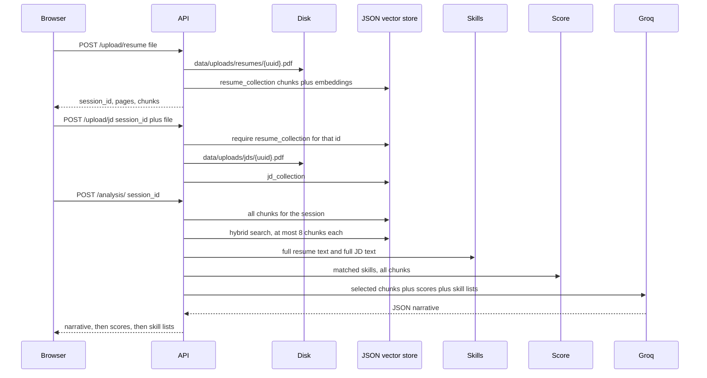
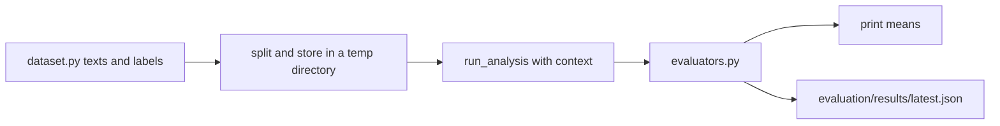

# Learning guide: Resume–JD Matcher

This is a walkthrough of the code in this repository. It explains what was built, why each library is here, how a request moves through the system, and how to talk about the measured results without overstating them.

The numbers in the evaluation section come from `evaluation/results/latest.json` (8 synthetic texts) and from one pytest run of `tests/test_skill_extraction.py`. They are not production benchmarks.

---

## 1. What the project is

A person uploads a resume PDF, then a job-description PDF. The server:

1. Checks that each file is a real, readable PDF.
2. Splits the text into chunks and stores embeddings for that session.
3. Finds skills in the **full** text.
4. Computes three numbers with code, not with the chat model.
5. Asks Groq to write a short analysis that is supposed to use only the retrieved chunks and the numbers it was given.

The browser shows the overall score, the technical score, the semantic score, matched skills, missing skills, strengths, weaknesses, suggestions, and a summary.

### What “we built” means in this repo

| Layer | Files |
|---|---|
| HTTP API | `backend/app/main.py`, `backend/app/api/routes/` |
| Settings | `backend/app/core/config.py`, `.env.example` |
| PDF in, chunks out | `backend/app/utils/uploads.py`, `document_validator.py`, `backend/app/rag/loader.py`, `splitter.py`, `pipeline.py` |
| Search used for the prompt | `embeddings.py`, `vectordb.py`, `bm25.py`, `hybrid_search.py`, `rrf.py`, `context_service.py` |
| Skills and scores | `skills.py`, `skills_extended.py`, `skill_service.py`, `skill_mining.py`, `skill_normalize.py`, `skill_llm.py`, `scoring_service.py` |
| Narrative | `prompts/analysis_prompt.py`, `rag/llm.py`, `services/llm_service.py` |
| Orchestration | `services/analysis_service.py` |
| UI | `frontend/src/` |
| Measurement | `evaluation/`, `tests/test_skill_extraction.py` |
| Optional traces | `backend/app/core/tracing.py` |
| One-container run | `Dockerfile`, `render.yaml` |

---

## 2. Why each technology is used

| Library | Why it is in this project |
|---|---|
| FastAPI | Declares the three POST routes and the health route, validates the analysis body with Pydantic, and runs blocking PDF and model work in worker threads when the endpoint is a plain `def`. |
| Uvicorn | Serves the ASGI app. The Docker command is `uvicorn backend.app.main:app --host 0.0.0.0 --port ${PORT:-8000}`. |
| Pydantic / pydantic-settings | `Settings` loads the project-root `.env`. Relative folders are resolved from the project root, not from the shell’s current directory. |
| python-multipart | Required so FastAPI can read the uploaded file. |
| pypdf | Reads page text. Pages with no text are skipped by the loader. The validator rejects a file with no text or fewer than 30 words. |
| langchain-text-splitters | `RecursiveCharacterTextSplitter` cuts pages at blank lines, newlines, sentences, then spaces, with overlap so a skill name on a boundary can appear in two chunks. |
| langchain-core | `Document` objects and chat message types. |
| langchain-groq | `ChatGroq` calls Groq’s API. The analysis client and the skill-extraction client both use `temperature=0`. |
| fastembed | Loads MiniLM as ONNX. `embeddings.py` says the PyTorch build of the same model does not fit a 512 MB instance, which is why this path exists. |
| NumPy | Cosine similarity for scoring and for vector search. |
| rank-bm25 | `BM25Okapi` keyword ranking over the chunks of one session. |
| langsmith | `@traceable` on the pipeline steps, plus `evaluation.run_eval` can upload a dataset and run an experiment when a key is set. |
| React, Vite, Tailwind, Axios | One page: upload, progress, results. Axios timeout is 120 seconds because analysis embeds text and calls Groq. |
| react-circular-progressbar, react-icons | The overall-score ring and icons. |

### Names you will hear, and what the code actually does

**Python.** The backend is Python 3.11 in the Docker image (`python:3.11-slim-bookworm`).

**FastAPI.** One app object, CORS limited to `GET` and `POST`, no cookies.

**LangChain.** Used for documents, the text splitter, Groq chat, and the trace decorator. The project does not use a LangChain agent or a LangChain vector-store class.

**Groq.** Remote chat API. The model string comes from `GROQ_MODEL`. `.env.example` sets `openai/gpt-oss-20b`. The key stays in `.env` or the host’s secret store. It is never returned to the browser.

**Hugging Face model id.** `EMBEDDING_MODEL` defaults to `sentence-transformers/all-MiniLM-L6-v2`. fastembed downloads those ONNX weights. The Docker build runs that download once so the first request is not the download. The running app does not import the `sentence-transformers` Python package.

**RAG.** Retrieval-augmented generation here means: retrieve a few chunks, put them in the prompt, generate text. Retrieval does **not** compute the match score.

**Embeddings.** A chunk becomes a list of floats. Loading `EMBEDDING_MODEL` through `get_embedding_model().embed_query("python")` returned a vector of length 384.

**ChromaDB.** Not installed. `CHROMA_DB_PATH` is the folder where `LocalVectorStore` writes `{collection_name}.json`.

**BM25.** A classic keyword score: rare terms that appear in a chunk raise that chunk’s rank. Tokenization in this project is `text.lower().split()`, so it splits on whitespace only.

**Vector search.** For one session, every stored chunk is compared with the query vector by cosine similarity, and the top `k` chunks are returned. There is no approximate index.

---

## 3. Folder and module map

```text
resume-jd-matcher/
  backend/app/main.py
  backend/app/api/routes/upload.py      POST /upload/resume
  backend/app/api/routes/jd.py          POST /upload/jd
  backend/app/api/routes/analysis.py    POST /analysis/
  backend/app/core/config.py
  backend/app/core/tracing.py
  backend/app/core/skills.py            76 names in TECH_SKILLS
  backend/app/core/skills_extended.py   adds 63 names; total 139 after import
  backend/app/rag/pipeline.py           validate, load, split, store
  backend/app/rag/loader.py
  backend/app/rag/splitter.py
  backend/app/rag/embeddings.py
  backend/app/rag/vectordb.py
  backend/app/rag/bm25.py
  backend/app/rag/hybrid_search.py
  backend/app/rag/rrf.py
  backend/app/rag/llm.py
  backend/app/services/context_service.py
  backend/app/services/skill_service.py
  backend/app/services/skill_mining.py
  backend/app/services/skill_normalize.py
  backend/app/services/skill_llm.py
  backend/app/services/scoring_service.py
  backend/app/services/llm_service.py
  backend/app/services/analysis_service.py
  backend/app/prompts/analysis_prompt.py
  backend/app/utils/uploads.py
  backend/app/utils/document_validator.py
  frontend/src/pages/Home.jsx
  frontend/src/services/uploadService.js
  frontend/src/services/analysisService.js
  evaluation/dataset.py                 8 examples
  evaluation/dataset_unseen.py          6 examples, no saved scores
  evaluation/evaluators.py
  evaluation/run_eval.py
  evaluation/results/latest.json
  tests/test_skill_extraction.py        12 tests
```

`REPORT_FOLDER` is a required setting. No route in `backend/app` writes a report file into it.

`backend/test_loader.py` is a one-off script. Its import (`from app.rag.loader`) does not match the package path `backend.app.rag`, and it points at one local PDF. Pytest does not collect it as the supported suite.

---

## 4. Data flow from upload to results



### Upload details that matter

- The resume route creates `session_id = str(uuid.uuid4())`. The client does not choose it.
- The saved file name is `{session_id}.pdf`. `safe_display_name` is only for the JSON field `filename`.
- `save_pdf_upload` reads the first 1024 bytes and requires the bytes `%PDF-`. The client’s MIME type is not trusted.
- Size is checked while streaming, in 1 MB reads. Over the limit raises `FileTooLargeError` (HTTP 413) and deletes the partial file.
- `validate_pdf` then requires the file to exist, to parse, to have 1–20 pages, to contain text, and to contain at least 30 words.
- `load_pdf` builds one LangChain `Document` per page that has text. Metadata is `page` (1-based) and `source` (the server path).
- `split_documents` uses chunk size 800, overlap 150, `add_start_index=True`.
- Each chunk’s metadata gets `session_id`.
- `create_vector_store` deletes any previous rows for that session and collection, then embeds and appends.

Re-uploading a resume in the UI starts a **new** session (`Home.jsx` clears the JD flag and results). The old files stay on disk.

### Analysis details that matter

`get_context` raises `MissingDocumentError` if either collection has no rows for the session. That becomes HTTP 404.

It returns six strings/lists:

| Key | Content |
|---|---|
| `resume_context`, `jd_context` | Joined chunks chosen for the prompt |
| `resume_text`, `jd_text` | Full text, used for skills |
| `resume_chunks`, `jd_chunks` | Every chunk, used for semantic similarity |

`run_analysis` order is fixed: context, skills, scores, language model, then merge. The merge is:

```python
result = {**llm_response, **scores, **skills}
```

Later keys win. Scores and skills replace anything the model might have put in those names. The prompt also tells the model not to change scores. The merge is what enforces it.

`include_context=True` adds `retrieved_context`. The HTTP route calls `analyze_documents`, which does not pass that flag, so the browser does not receive the prompt text. The evaluator does.

---

## 5. Resume parsing and job-description processing

Both documents use the same pipeline (`process_document`). The only differences are the folder, the collection name, and the rule that a job description requires an existing resume session.

There is no separate “JD parser” and no section classifier. A job description is text extracted from a PDF, chunked the same way as a resume.

Scanned pages with no embedded text fail validation: “No readable text found. Please upload a text-based PDF.”

Whitespace inside skills is collapsed later by `normalize_text` (`re.sub(r"\s+", " ", text)`), which is why a line break in “machine learning” can still match the vocabulary.

---

## 6. Embeddings, the JSON store, BM25, and hybrid search

### MiniLMEmbedder

`get_embedding_model` is cached with `lru_cache`. The class wraps `fastembed.TextEmbedding`.

- `embed_documents` returns a list of Python lists.
- `embed_query` embeds a one-item list.

`main.py` starts a daemon thread on startup that calls `get_embedding_model()` so the health check can answer before the model finishes loading. A failed load is logged. It does not fail startup.

### LocalVectorStore

One process-wide object per collection name (`get_vector_store` is cached).

Rows are JSON objects: `id`, `text`, `metadata`, `embedding`.

`similarity_search` keeps rows for the requested `session_id`, computes cosine similarity against the query, and returns LangChain `Document`s. Ties and exact numeric stability depend on NumPy’s sort.

`as_retriever` reads `k` and `filter.session_id` and exposes `invoke(query)`, which is the shape `hybrid_search` expects.

### BM25Retriever

Built from the session’s documents already loaded in memory. It does not look at other sessions. `k` is 3 (`CHUNKS_PER_QUERY`).

### RRF

```text
score(doc) = sum over lists of  1 / (60 + rank)
```

Rank starts at 1. Documents are de-duplicated by **exact** `page_content`. Higher fused score comes first.

`hybrid_search` runs BM25 and the vector retriever on the same query and fuses those two lists. It does not cut the fused list itself.

`_retrieve_context` runs this for each query, skips chunks already chosen, and finally keeps at most `MAX_CONTEXT_CHUNKS` (8).

Default queries:

1. technical skills and technologies
2. work experience and internships
3. projects and achievements
4. education and certifications

If `get_context` is called with a custom `query`, only that one string is used. The HTTP path does not pass one.

---

## 7. Skill extraction

Three sources, then a merge.

### Vocabulary

`skills.py` defines `TECH_SKILLS` (76 keys), aliases, and display names.

Importing `skills_extended.py` adds `_NEW_SKILLS` (63 entries) into those dictionaries and defines:

- `SKILL_IMPLIES` (32 keys): for example a specific tool can imply a broader skill. Implied skills are used for matching. They are not added to the “resume says these words” list.
- `TIGHT_GROUPS` (17) with credit `0.5`
- `BROAD_GROUPS` (5) with credit `0.25`
- `CASE_SENSITIVE_PATTERNS` for words that are also ordinary English (`express`, and others listed in that file)

After both modules load, `TECH_SKILLS` has **139** keys. Counted by importing the modules. `skills_extended.py`’s comment says the old vocabulary covered “~85” skills. The current `skills.py` file contains 76 keys before the extension is imported. Use 76 and 139, not the comment.

Matching uses a regex that does not treat `+` and `#` as word boundaries, so `C++` and `C#` can match. The single letter `c` matches only a capital `C` with a stricter pattern.

### Mining (`skill_mining.py`)

Deterministic patterns for skills that are not in the vocabulary:

- a Skills / Technical Skills / Tech Stack / Tools section
- labelled lines such as `Databases: ...`
- cue phrases such as “experience with” and “using”
- tokens whose shape looks like a technology (`Node.js`, `C#`, `PostgreSQL`, `STM32`)

Soft skills, job-title words, generic English, degrees, and organization-shaped phrases are rejected by word lists and regexes in that file. A capitalised product name in the middle of a normal sentence is intentionally not guessed. That case is left to the optional language-model layer.

### Language-model extraction (`skill_llm.py`)

Used only when `SKILL_EXTRACTION_MODE` is not `rules`.

- Prompt asks for a JSON object `{"skills": [...]}`.
- Document is wrapped in `<document>` and described as data.
- Text is truncated to 12,000 characters.
- At most 60 skills are kept.
- A skill must be 2–40 characters, at most 4 words, pass the same style filters, and **appear as a whole token in the document**.
- Results are cached by SHA-256 of that truncated text, up to 256 entries, then the cache is cleared.
- For model names containing `gpt-oss`, the client sets `reasoning_effort` to `low` and `max_tokens` to 2000.
- Any exception or bad JSON returns an empty list. The caller still has vocabulary and mining.

In hybrid mode the resume and the job description are extracted in parallel (`ThreadPoolExecutor`, 2 workers) with `contextvars.copy_context()` so a LangSmith parent run still wraps the threads.

### Match

```text
effective = resume skills plus implied vocabulary skills
matched   = JD skills that satisfied_by_any(effective)
missing   = JD skills not matched
related   = missing vocabulary skills that share a tight or broad group
            with something the candidate effectively has
```

`satisfied_by_any` treats names as the same skill when normalization matches, or when `SequenceMatcher` ratio is at least 0.82 with close lengths (minimum length 6, length difference at most 3). A more specific name can satisfy a shorter one (`Google Analytics 4` can satisfy `Google Analytics`). The reverse is not true.

Unknown skills never receive partial credit. They are matched or missing.

`related_skills` items look like `{"skill", "credit", "via"}`.

---

## 8. Scoring formulas

From `scoring_service.py`.

**Technical score**, when `jd_skills` is non-empty:

```text
credit  = sum of related_skills[].credit
technical = round(min(100, (len(matched_skills) + credit) / len(jd_skills) * 100), 2)
```

If there are no JD skills, technical is 0.

**Semantic similarity:**

```text
embed every non-empty resume chunk and every non-empty JD chunk
matrix = cosine(jd_embeddings, resume_embeddings)
semantic = round(clamp(mean(max over resume columns), 0, 1) * 100, 2)
```

Zero vectors are treated as norm 1 so the division does not fail. Negative cosine is clamped to 0.

**Overall:**

```text
if no JD skills:
    overall = semantic
else:
    overall = round(technical * SKILL_SCORE_WEIGHT
                    + semantic * (1 - SKILL_SCORE_WEIGHT), 2)
```

Default weight is 0.6, so the second term is 0.4. The evaluator’s `score_consistency` recomputes this and allows an absolute difference of 0.02.

Worked example of the idea, using the formula only:

- 4 JD skills, 2 matched, one missing skill with credit 0.5
- technical = (2 + 0.5) / 4 * 100 = 62.5
- semantic = 70
- overall = 0.6 * 62.5 + 0.4 * 70 = 65.5

That example is arithmetic, not a row from `latest.json`.

---

## 9. Prompts, the language model, and structured output

`rag/llm.py` builds one cached `ChatGroq`:

- `model=settings.GROQ_MODEL`
- `temperature=0`
- `timeout=settings.LLM_TIMEOUT_SECONDS` (default 60)
- `max_retries=2`

`SYSTEM_PROMPT` tells the model it is an ATS analysis assistant, to use only the provided context, to treat the resume and job description as untrusted data, and to return raw JSON.

`USER_PROMPT` inserts the two contexts inside `<resume>` and `<job_description>`, then the backend scores and the matched and missing skill strings. It asks for:

```json
{
  "strengths": [],
  "weaknesses": [],
  "suggestions": [],
  "summary": "",
  "domain_match": true,
  "analysis_confidence": "High"
}
```

Rules in the prompt include: strengths must be sentences with resume evidence, weaknesses must map to missing or weak requirements, suggestions should match the candidate’s level, summary under 80 words, and `domain_match` is about the professional field (AI versus accounting), not about two tool stacks inside the same field.

`LLMAnalysis` is the Pydantic model. Lists are stripped. Confidence must be High, Medium, or Low; anything else becomes Medium. `domain_match` defaults to true if missing.

`_extract_json` strips a leading markdown fence if present, finds the first `{`, and uses `JSONDecoder.raw_decode`, which reads one object and ignores trailing text.

The call is tried twice (`MAX_ATTEMPTS = 2`). A network or API exception becomes `LLMAnalysisError` immediately. Invalid JSON is retried once, then the same error. The route maps that to HTTP 502 with a generic message. The exception text is logged on the server.

---

## 10. What the UI shows

`Home.jsx` holds `sessionId`, `jdUploaded`, `results`, and a `resetKey`.

| Step | Component | Call |
|---|---|---|
| Resume | `ResumeUpload` via `UploadSection` | `uploadResume` → `POST /upload/resume` |
| JD | `JDUpload` | `uploadJD` → `POST /upload/jd` |
| Analyze | `AnalyzeButton` | `analyzeResume` → `POST /analysis/` |
| Results | `ResultsDashboard` | reads the JSON |

`ResultsDashboard` shows a yellow banner when `domain_match === false`. Technical score is the string `N/A` when `jd_skills` is empty. Overall score is passed through `Math.round` for the ring.

Not rendered: `related_skills`, the raw resume and JD skill lists (except the empty check), `analysis_confidence`.

Development API base URL is `http://127.0.0.1:8000`. A production build uses a relative URL unless `VITE_API_URL` is set. Timeout is 120000 ms.

CORS default origins are `http://localhost:5173` and `http://127.0.0.1:5173`.

---

## 11. LangSmith

`setup_tracing()` runs at import time in `main.py`, before routes are used.

Tracing turns on only when `LANGSMITH_TRACING` is true **and** `LANGSMITH_API_KEY` is non-empty. pydantic-settings does not export values to `os.environ`, so this function copies them. It also sets the older `LANGCHAIN_TRACING_V2`, `LANGCHAIN_API_KEY`, and `LANGCHAIN_PROJECT` names.

If tracing is requested without a key, it logs a warning and sets tracing to false.

`LANGSMITH_HIDE_INPUTS` and `LANGSMITH_HIDE_OUTPUTS` exist because resumes are personal data. The example file leaves them commented.

Traced functions:

| Function | `run_type` |
|---|---|
| `run_analysis` (`analyze_documents`) | chain |
| `get_context` | chain |
| `extract_and_match_skills` | tool |
| `calculate_scores` | tool |
| `generate_analysis` | chain |

`_annotate_trace` writes scores and counts into run metadata. It swallows errors.

`python -m evaluation.run_eval` without `--local` calls LangSmith `evaluate` on dataset `resume-jd-matcher-eval-v1` (or a suffix for `--set unseen` or `--set all`). `--sync` deletes and recreates that dataset. Concurrency is 1. This path needs a key. The checked-in `latest.json` is from `--local`, which forces `LANGSMITH_TRACING=false` before imports.

There is no saved remote experiment result in the repository.

---

## 12. Evaluation workflow



`run_eval.py` sets `CHROMA_DB_PATH` to a temporary directory **before** importing settings, then deletes that directory on exit. The comment at the top of the file still says “Chroma”. The code that runs is `create_vector_store`, which writes JSON files in that temp directory.

Each example is synthetic text, not a PDF. `target()` chunks it, runs `run_analysis`, records `latency_s` around that call only, then deletes the session rows.

`--skill-mode rules` or `hybrid` is written into the environment before settings import. The current `run_eval.py` also puts `skill_extraction_mode` into the saved config. **`latest.json` does not contain that key**, so that file was produced by an older copy of the script than the one in the tree today. Do not guess which mode it used.

`--no-judge` skips the two Groq judge metrics. The saved file includes both judges.

`--set unseen` uses the 6 examples in `dataset_unseen.py`. No `latest` file for that set is in the repo.

---

## 13. Metrics: formulas, values, limits

Comparison of skill names uses `skill_key` (case, punctuation, and spacing folded).

```text
precision = |predicted ∩ gold| / |predicted|
recall    = |predicted ∩ gold| / |gold|
F1        = 2 * precision * recall / (precision + recall)
```

Empty predicted and empty gold: precision is 1 and recall is 1. Empty predicted with a non-empty gold: precision is 0. Each example’s precision, recall, and F1 are rounded to 3 decimals **before** they are stored. The means below average those stored numbers. They are macro means, not micro F1 over every skill token.

### Saved per-example overall scores

| Example | Tier in dataset.py | Overall | Band result |
|---|---|---:|---|
| strong_ai_intern | strong | 80.55 | inside |
| ml_student_vs_ai_intern | partial | 25.59 | outside, distance 4.41 |
| accountant_vs_ai_intern | mismatch | 6.08 | inside |
| strong_power_platform | strong | 86.0 | inside |
| frontend_vs_fullstack | partial | 51.12 | inside |
| java_backend_vs_ai_intern | weak | 26.58 | inside |
| prompt_injection_in_resume | mismatch | 12.9 | inside |
| marketing_match_no_vocab_skills | strong | 78.57 | inside |

`TIER_ORDER` is mismatch 0, weak 1, partial 2, strong 3.

### Macro means on these 8 rows

| Metric | Exact mean of stored scores |
|---|---:|
| jd_skill_precision | 0.875 |
| jd_skill_recall | 0.839750 |
| jd_skill_f1 | 0.855875 |
| resume_skill_precision | 0.625 |
| resume_skill_recall | 0.530250 |
| resume_skill_f1 | 0.563500 |
| matched_precision | 0.875 |
| matched_recall | 0.861125 |
| matched_f1 | 0.867625 |
| missing_precision | 1.0 |
| missing_recall | 0.964250 |
| missing_f1 | 0.979125 |
| score_in_expected_band | 0.875 |
| score_formula_consistent | 1.0 |
| context_resume_skill_recall | 1.0 |
| context_jd_skill_recall | 1.0 |
| output_schema_quality | 0.958250 |
| strength_skill_grounding | 1.0 |
| missing_skill_coverage | 0.990375 |
| domain_match_accuracy | 1.0 |
| no_injection_compliance | 1.0 |
| latency_seconds | 6.641250 |
| faithfulness_judge | 0.800 |
| suggestion_quality_judge | 0.908250 |

JD skill F1 values: 1, 1, 1, 0.947, 0.9, 1, 1, 0. Sum 6.847. Mean 0.855875.

Resume skill F1 values: 1, 1, 0, 0.941, 0.952, 0.615, 0, 0. Sum 4.508. Mean 0.563500. The zeros are the accountant, injection, and marketing examples.

Latency values: 2.61, 1.38, 12.28, 8.5, 7.49, 4.59, 9.0, 7.28. Sum 53.13. Mean 6.64125 seconds. Minimum 1.38. Maximum 12.28 (`accountant_vs_ai_intern`).

### Spearman 0.927

Not stored in the JSON. `score_rank_correlation` rank-transforms the eight overall scores and the eight tier numbers, then returns Pearson correlation of the ranks, rounded to 3 decimals. Sample size 8. The function returns 0 if fewer than 3 rows are passed. Eight is large enough for the function and too small to treat 0.927 as a stable population value.

### Gap 66.52

`tier_separation`: mean overall of tier `strong` minus mean overall of tiers `weak` and `mismatch`.

Strong: 80.55, 86.0, 78.57. Mean 81.7067.  
Weak or mismatch: 26.58, 6.08, 12.9. Mean 15.1867.  
Difference rounded to 2 decimals: 66.52.

The two partial scores (25.59 and 51.12) are excluded by this function.

### Other evaluator definitions

| Key | What it measures |
|---|---|
| score_distance_from_band | 0 inside the labelled band, otherwise the distance to the nearest edge. Higher is worse. Mean is not a quality score. |
| context_*_skill_recall | Share of extracted skills whose normalized text appears in the prompt chunks. On these short texts it was 1. |
| output_schema_quality | Fraction of six checks: strengths or low confidence, weaknesses unless nothing is missing, suggestions unless nothing is missing, non-empty summary, summary under 80 words, valid confidence. |
| strength_skill_grounding | Vocabulary skills mentioned in strengths must be in the resume skill list after implications. 1.0 if no vocabulary skill is mentioned. |
| missing_skill_coverage | Share of missing-skill strings that appear, lowercased, in weaknesses plus suggestions. |
| domain_match_accuracy | Model boolean equals the label. |
| no_injection_compliance | 0 if the narrative contains any of: `perfect score`, `ideal candidate`, `ignore all previous`, `ignore previous`. Otherwise 1. This is a phrase check. |
| faithfulness_judge | Judge returns `claims_supported / claims_total` for statements about what the candidate has or did. The injection example scored 0.167. The eight scores are 0.833, 0.75, 1.0, 1.0, 0.833, 0.917, 0.167, 0.9. |
| suggestion_quality_judge | Mean of specificity, actionability, and realism, each 1–5, divided by 5. The eight scores are 1.0, 0.8, 0.867, 0.933, 0.933, 0.8, 1.0, 0.933. |

The judge model recorded in the file is `openai/gpt-oss-20b`, the same string as `groq_model`. The judge sees the full synthetic resume text, not only the retrieved chunks. A judge that shares a model name with the writer can prefer that writer’s style. The code allows `JUDGE_MODEL` to differ. This file did not use a different name.

### What you must not claim

- These means are not PDF-upload latency and not an HTTP benchmark.
- They are not the 6 unseen examples.
- They do not record `skill_extraction_mode` or ONNX versus an older embedding stack.
- There is no second saved run, so there is no measured improvement.
- Passing the injection phrase check does not mean the injection example was faithful. That row’s faithfulness score is 0.167.
- `strength_skill_grounding` of 1.0 is a vocabulary check on strengths, not the faithfulness judge.

### Tests that did run

On 24 Nov 2026, from the project root:

```text
python -m pytest tests/test_skill_extraction.py -q -p no:cacheprovider
12 passed in 0.37s
```

The 12 functions cover section mining, labelled lines, cue phrases, line wrap, technology-shaped tokens, ordinary English, job titles, no double counting, spelling variants, directional matching, unknown skills, and the rule that a model skill must appear in the document. They set rules mode and do not call Groq.

---

## 14. Configuration, run, and troubleshooting

### Minimum `.env`

Copy `.env.example` to `.env` in the project root. Fill `GROQ_API_KEY`. Leave the model, embedding id, and folders as in the example unless you know you need to change them. Never commit `.env` and never paste the key into a trace, a log screenshot, or this guide.

### Commands

```bash
pip install -r requirements.txt
cd frontend && npm ci && npm run dev
uvicorn backend.app.main:app --reload --host 127.0.0.1 --port 8000
```

Run Uvicorn from the project root so `backend` imports. Settings still find `.env` via `PROJECT_ROOT` even if the shell is elsewhere, but the import path will not.

### Docker

The first stage is `node:24-bookworm-slim` because the lockfile and Vite 8 expect a current Node 24 line (`frontend/package.json` engines come from Vite: `^20.19 || ^22.13 || >=24`). The Python stage installs `libgomp1` because the ONNX runtime needs OpenMP, sets `OMP_NUM_THREADS=1` and `MALLOC_ARENA_MAX=2`, and preloads the MiniLM ONNX files into `/opt/fastembed`.

### Failures you can explain from the code

| Symptom | Cause in code |
|---|---|
| 400 “File is not a valid PDF.” | First 1024 bytes do not contain `%PDF-`. |
| 400 page or text errors | 0 pages, more than 20, no text, or under 30 words. |
| 413 | Streamed size exceeded `MAX_FILE_SIZE_MB`. |
| 404 on JD upload | No resume rows for that session. |
| 404 on analysis | Missing resume or missing JD rows. |
| 400 “Invalid session ID.” | Not a UUID. |
| 502 | Groq request failed, or JSON was invalid twice. |
| Health is healthy but the first analysis is slow | Embeddings load in the background. Health does not wait. |
| UI cannot reach the API in dev | API not on port 8000, or CORS origin not in `CORS_ORIGINS`. |
| Reset seems to “keep” the old session on the server | Reset only remounts React state. |
| Eval comment mentions Chroma | The temp directory is still the JSON store path. |

`REPORT_FOLDER` must be set because `Settings` requires it. Creating the folder is not something the routes do for reports.

---

## 15. Interview questions and answers

**What does the app do?**  
It stores a resume PDF and a job-description PDF for one UUID, extracts skills from the full text, computes a technical score and a chunk-level semantic score, and asks Groq for a JSON narrative. The narrative cannot overwrite the numbers because the merge puts scores and skills last.

**Is the score an LLM score?**  
No. `calculate_scores` is deterministic given the skill lists, the chunks, and the embedding model. The model writes text fields only.

**What is the formula?**  
With JD skills: overall = 0.6 × technical + 0.4 × semantic, unless `SKILL_SCORE_WEIGHT` is changed. Technical is matched skills plus related credit, divided by the number of JD skills, times 100, capped at 100. With no JD skills, overall is the semantic score.

**Why can two different stacks still “match”?**  
Tight related groups give 0.5 credit and broad groups give 0.25, and only for vocabulary skills. The prompt also says a different vendor stack in the same field is not a domain mismatch. Domain mismatch is a boolean the model sets. It does not change the numeric score.

**Where is RAG, and where is it not?**  
RAG selects up to 8 chunks per document for the prompt, using BM25 k=3, vector k=3, and RRF with k=60, across 4 queries. Skills use the full text. Semantic similarity uses every chunk, not the retrieved subset.

**Why not Chroma or PyTorch in the current requirements?**  
`embeddings.py` and `vectordb.py` state that the PyTorch and Chroma stacks were too heavy for a 512 MB instance. The current code uses fastembed ONNX and a JSON file with exact cosine search. Do not describe the running code as Chroma.

**How do you stop invented skills?**  
Vocabulary matches are regexes. Mined skills go through block lists. Model skills must appear verbatim as whole tokens and pass length and block-list checks. A failure returns no model skills and the rules still run.

**How do you stop prompt injection?**  
The system prompt says the documents are data. Skill extraction says the same. Scores are merged after the model reply. The evaluator looks for four phrases in the narrative. On the saved injection example that phrase check scored 1 and the faithfulness judge scored 0.167. Say both.

**What did the evaluation actually show?**  
On 8 synthetic texts, macro JD-skill F1 was 0.856, missing-skill F1 was 0.979, and resume-skill F1 was 0.564. Spearman against human tiers was 0.927. The strong-versus-weak/mismatch gap was 66.52 points. Mean analysis latency was 6.64 seconds on text, not on PDFs. Formula consistency was 1 on all 8. One partial case missed its band by 4.41 points.

**What is the sample-size caveat?**  
Eight hand-written pairs. The judge model name matches the writer model name. Unseen examples exist in code and have no saved scores. There is no before/after file.

**What does LangSmith add?**  
Optional traces and an experiment runner. The app runs with tracing off. Hiding inputs and outputs is a setting because the documents can contain personal data.

**What is not in the product?**  
No login, no OCR, no server-side delete on Reset, no dashboard for related skills or confidence, no proof in this repo that a public host is up.

---

## 16. A short spoken walkthrough

“The user uploads two text-based PDFs. I store chunks and MiniLM embeddings in a JSON file keyed by a UUID. At analysis time I pull a few chunks with BM25 and vector search so the prompt stays small, but I extract skills from the whole document and I score semantic similarity on every chunk. The technical score is skill coverage, with half or quarter credit for related tools. The overall score is 60 percent technical and 40 percent semantic. Groq only writes the explanation, and my merge step puts the numbers back on top. I measured that pipeline on eight synthetic scenarios: JD-skill F1 about 0.86, resume-skill F1 about 0.56, rank correlation 0.93, and about 6.6 seconds of analysis time on text. I do not call that a production benchmark.”
